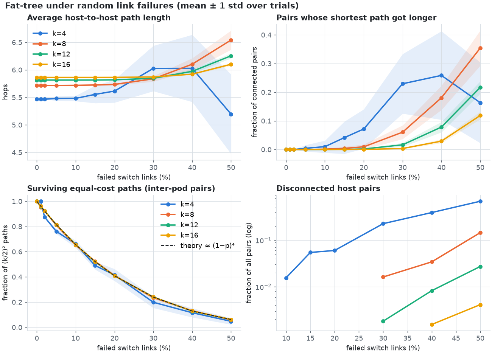
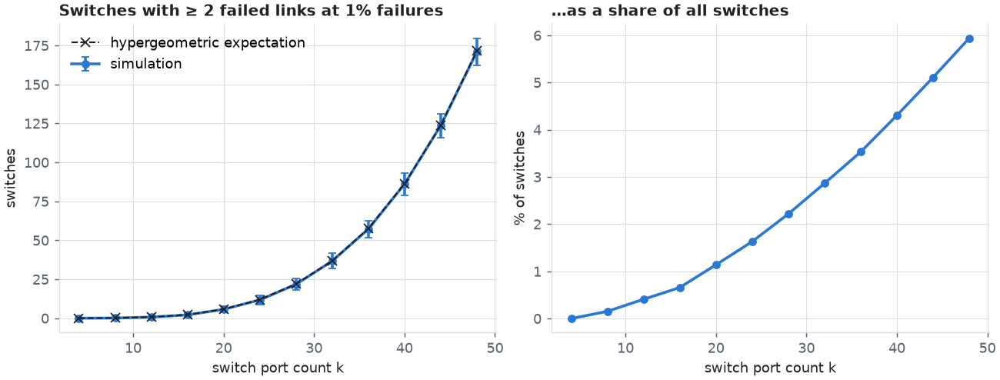
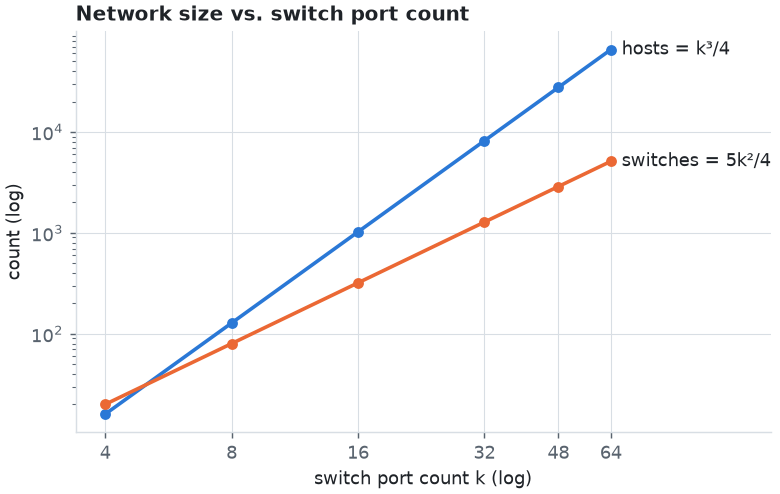

# Fat-Tree Topology Generator and Failure Analysis

Homework 1, *Communication Networks for Data Centers and AI* (2026).

This project generates three-tier **k-ary fat-tree** data-center topologies
following Al-Fares et al. [1], injects random **link failures**, and measures how
path structure and connectivity degrade as a function of the failure rate and the
switch port count `k`.

## Contents

- [Topology design](#topology-design)
- [Input parameters](#input-parameters)
- [Failure model](#failure-model)
- [How to run](#how-to-run)
- [Metrics](#metrics)
- [Results](#results)
  - [Experiment 1: path metrics vs. link-failure rate (advanced)](#experiment-1-path-metrics-vs-link-failure-rate-advanced)
  - [Experiment 2: switches with multiple failed links vs. k (intermediate)](#experiment-2-switches-with-multiple-failed-links-vs-k-intermediate)
  - [Experiment 3: network size vs. k (basic)](#experiment-3-network-size-vs-k-basic)
- [Repository layout](#repository-layout)
- [AI usage](#ai-usage)
- [References](#references)

## Topology design

A k-ary fat-tree is built from identical `k`-port switches (`k` even) in three tiers:

| Tier | Count | Connections |
|---|---|---|
| Core | (k/2)² | one port to each of the k pods |
| Aggregation | k/2 per pod (k²/2 total) | k/2 down to every edge switch in its pod, k/2 up to core |
| Edge | k/2 per pod (k²/2 total) | k/2 down to hosts, k/2 up to every aggregation switch in its pod |
| Hosts | k³/4 | one link to an edge switch |

**Wiring rule (from [1]).** Core switches form a (k/2)×(k/2) grid `c_j_i`.
Aggregation switch `a` of *every* pod connects to the whole row `j = a` of the
grid. Equivalently, core switch number `n` (row-major) attaches to aggregation
switch `⌊n / (k/2)⌋` in each pod. As a result, every core switch reaches every pod
exactly once, and two hosts in different pods are connected by **(k/2)²
equal-cost 6-hop paths**.

**Totals.** k³/4 hosts, 5k²/4 switches, and 3k³/4 links. One third of the links
are host–edge, one third edge–aggregation, and one third aggregation–core.

**Addressing.** Every node also gets the paper's IP address:

- pod switches: `10.pod.switch.1` (edge switches are 0…k/2−1, aggregation switches are k/2…k−1)
- core switches: `10.k.j.i`
- hosts: `10.pod.switch.ID` with ID in [2, k/2+1]

The graph is a `networkx.Graph`. Each node is named `h_<pod>_<edge>_<id>`,
`e_<pod>_<i>`, `a_<pod>_<i>` or `c_<j>_<i>`, and carries the attributes `layer`,
`pod` and `ip`.

**Verification.** [test_fattree.py](test_fattree.py) checks the
following for k = 2…12:

- all closed-form counts
- every switch uses exactly k ports
- links exist only between adjacent tiers
- each core switch reaches every pod exactly once
- hop distances are 2, 4 and 6
- there are (k/2)² inter-pod shortest paths
- the IP format and uniqueness

## Input parameters

| Parameter | CLI flag | Config key | Default | Meaning |
|---|---|---|---|---|
| Port count | `--k` | `k` | 4 | Switch port count. Must be an even integer ≥ 2. Sets the network scale. |
| Failure rate | `--fail-pct` | `fail_pct` | 0 | Percentage (0–100) of failable links to fail. |
| Seed | `--seed` | `seed` | none | RNG seed, so a run can be reproduced exactly. |
| Host links failable | `--include-host-links` / `--no-include-host-links` | `include_host_links` | false | Also allow host–edge links to fail. |
| Output file | `--output` | `output` | none | Write the resulting topology as node-link JSON, including the list of failed links. |
| Config file | `--config` | – | none | JSON file with any of the keys above. |

Values given on the command line override values from the config file. An unknown
config key is rejected, so typos fail loudly. Example config file:

```json
{"k": 8, "fail_pct": 5, "seed": 42, "include_host_links": false}
```

## Failure model

- A failure percentage `p` removes **exactly** `round(p/100 · L)` links. They are
  chosen uniformly at random without replacement, where `L` is the number of
  failable links. Using an exact count rather than independent per-link coin
  flips removes one source of variance and makes "x% of links failed" literally
  true.
- **By default only switch-to-switch links fail** (edge–aggregation and
  aggregation–core, so L = k³/2). A failed host link trivially isolates a single
  host and says nothing about the fabric's redundancy. Host links can be made
  failable with `--include-host-links`.
- Failed links are removed from a copy of the graph. The original topology is
  never modified.

## How to run

Requires Python ≥ 3.10.

```bash
python3 -m venv .venv
source .venv/bin/activate
pip install -r requirements.txt
```

Generate a topology and print a summary:

```bash
python fattree.py --k 4
python fattree.py --k 8 --fail-pct 5 --seed 42
python fattree.py --config my_config.json --fail-pct 10 --output topo.json
```

Example output:

```json
{
  "config": {"k": 8, "fail_pct": 5, "seed": 42, "include_host_links": false, "output": null},
  "topology": {"hosts": 128, "edge": 32, "agg": 32, "core": 16, "switches": 80, "links": 384},
  "failed_links": 13,
  "host_pair_reachability": 1.0
}
```

Reproduce all experiments and plots. This takes about 80 s; `--quick` takes about
15 s with fewer trials:

```bash
python experiments.py
```

Run the tests:

```bash
python -m pytest -q
```

## Metrics

All path metrics in [fattree.py](fattree.py) are computed over
**all unordered host pairs**:

| Metric | Definition |
|---|---|
| `avg_hops` | Mean shortest-path length (in links) over host pairs that are still connected. |
| `stretched_fraction` | Share of connected pairs whose shortest path is longer than in the intact tree (baseline lengths are 2, 4 or 6). |
| `ecmp_survival` | For inter-pod pairs: the fraction of the original (k/2)² equal-cost 6-hop paths that still exist. A pair forced onto a longer path, or disconnected, counts as 0. |
| `disconnected_fraction` | Share of all host pairs with no path at all. |

**Efficient computation.** Hosts are leaves and never relay traffic, so one BFS
with shortest-path counting is run from each *edge switch* over the switch-only
subgraph. Each edge-switch pair is then weighted by the number of hosts still
attached on each side. This costs k²/2 BFS runs instead of k³/4 and is exact.
The tests check it against a brute-force
`networkx` reference on every host pair, with and without host-link failures.

## Results

### Experiment 1: path metrics vs. link-failure rate (advanced)

**Question.** A fat-tree is designed with massive path redundancy. How much
failure can it absorb before hosts notice, and in what form do they notice
(longer paths, fewer parallel paths, or lost connectivity)? How does the port
count `k` change the answer?

**Setup.**

- k ∈ {4, 8, 12, 16}, which is 16 to 1,024 hosts
- failure rate p ∈ {0, 1, 2, 5, 10, 15, 20, 30, 40, 50}% of switch links
- 30 independent random failure sets per (k, p) point, with a fixed master seed of 2026
- the curves show the mean, and the shaded bands show ±1 standard deviation



Selected values (means over 30 trials):

| k | p | avg hops | stretched | ECMP survival | theory (1−p)⁴ | disconnected |
|---|---|---|---|---|---|---|
| 4 | 10% | 5.48 | 1.0% | 0.661 | 0.661 | 1.56% |
| 4 | 30% | 6.03 | 23.0% | 0.199 | 0.203 | 22.6% |
| 8 | 30% | 5.84 | 6.1% | 0.235 | 0.237 | 1.62% |
| 16 | 20% | 5.86 | 0.03% | 0.409 | 0.409 | 0 |
| 16 | 30% | 5.87 | 0.36% | 0.240 | 0.240 | 0 |
| 16 | 50% | 6.10 | 11.9% | 0.063 | 0.062 | 0.41% |

**Discussion.**

1. **Path length is a poor health indicator.** For k ≥ 8 the average path length
   stays essentially flat up to about 20% failures. A pair keeps its 6-hop length
   as long as *any one* of its (k/2)² paths survives. Looking at hop count alone,
   a k=16 fabric with 20% of its links dead looks almost identical to a healthy
   one.
2. **What actually degrades is path diversity.** An inter-pod path uses exactly
   4 switch links (edge→agg→core→agg→edge). It therefore survives with
   probability C(L−4, m)/C(L, m) ≈ (1−p)⁴. The dashed theory curve lies on top of
   the measurements, and the curve is **independent of k**: every k loses the
   same *fraction* of its equal-cost paths. In ECMP terms, the remaining paths
   carry more load each. Capacity degrades smoothly even while hop count and
   reachability look perfect.
3. **Larger k buys robustness in absolute terms.** The surviving fraction is the
   same for every k, but the *number* of paths is (k/2)², so the chance of losing
   *all* of them falls sharply with k. At 30% failures, 22.6% of host pairs are
   cut off in a k=4 tree (only 4 paths per pair). For k=8 the figure is 1.6%, for
   k=12 it is 0.2%, and k=16 has no disconnected pairs. Stretch follows the same
   ordering.
4. **A selection-bias trap.** For k=4 at 50% failures the average path length
   *drops* below the intact value (5.20 vs. 5.47). The network did not get
   better. Two-thirds of the pairs are disconnected, and the survivors are mostly
   nearby pairs (same edge switch or same pod) with short paths. An average over
   connected pairs must always be reported together with the disconnected
   fraction.

**Significance.** In a fat-tree, random failures first eat into bisection
bandwidth and load balancing (ECMP diversity), long before they cause stretch or
partitions. Monitoring should therefore track path or ECMP-group health, not just
reachability. Choosing a larger k widens the safety margin before partitions
appear.

### Experiment 2: switches with multiple failed links vs. k (intermediate)

**Question.** With a fixed 1% link-failure rate, how many switches end up with
two or more failed ports? These are the switches most likely to need operator
attention. How does that number scale with network size?

**Setup.**

- k = 4, 8, …, 48 (up to 27,648 hosts and 2,880 switches)
- exactly 1% of switch links failed
- 500 trials per k
- the simulation is compared with the exact expectation: a switch with d failable
  ports has X ~ Hypergeometric(L, d, m) failed links, so
  E[count] = Σ_switches P(X ≥ 2)
- edge switches have d = k/2 (uplinks only), and aggregation and core switches have d = k



| k | failed links | switches | ≥2-failure switches (sim, mean ± std) | theory | share |
|---|---|---|---|---|---|
| 4 | 0 | 20 | 0 | 0 | 0% |
| 8 | 3 | 80 | 0.12 ± 0.33 | 0.14 | 0.15% |
| 16 | 20 | 320 | 2.10 ± 1.24 | 2.24 | 0.66% |
| 24 | 69 | 720 | 11.7 ± 2.8 | 11.9 | 1.6% |
| 32 | 164 | 1,280 | 36.7 ± 4.9 | 36.8 | 2.9% |
| 48 | 553 | 2,880 | 171.1 ± 8.6 | 171.5 | 5.9% |

**Discussion.**

- The simulation matches the hypergeometric expectation within noise at every k,
  which also validates the failure sampler.
- At k=4, 1% of 32 links rounds to **0** failures. Small trees cannot express a
  1% failure rate at all.
- The count grows roughly like **k⁴**: doubling k from 24 to 48 multiplies it by
  about 14.6 ≈ 2^3.9. The reason is that a switch with k failable ports expects
  λ = k·p failed links, so for small λ, P(X ≥ 2) ≈ λ²/2 ∝ k². There are Θ(k²)
  switches, which gives Θ(k⁴) in total.
- The **share** of affected switches grows like k² (from 0.15% at k=8 to 5.9% at
  k=48), even though the per-link failure rate is constant. Each switch has more
  ports, so it collects failures faster.

**Significance.** The same per-link reliability produces a growing *fraction* of
multiply-degraded switches as port count rises. A switch with several failed
uplinks loses a proportional share of its capacity, and the ECMP hashing on it
becomes uneven. Repair and maintenance load at large k is driven by this
super-linear growth, not just by the raw link count.

### Experiment 3: network size vs. k (basic)

**Setup.** Closed-form sizes for k ∈ {4, 8, 16, 32, 48, 64}. The generator
reproduces them exactly, as checked by the unit tests for k ≤ 12.



| k | hosts (k³/4) | switches (5k²/4) | links (3k³/4) |
|---|---|---|---|
| 4 | 16 | 20 | 48 |
| 8 | 128 | 80 | 384 |
| 16 | 1,024 | 320 | 3,072 |
| 32 | 8,192 | 1,280 | 24,576 |
| 48 | 27,648 | 2,880 | 82,944 |
| 64 | 65,536 | 5,120 | 196,608 |

**Discussion.** Hosts grow as k³ while switches grow only as k², so the number of
switches per host falls as 5/k. This is the paper's core economic argument:
commodity switches with more ports support a much larger network without
oversubscription, at a lower cost per host. k=48 already supports about 27k hosts
with 2,880 identical switches. The plot is log–log, so the slopes of 3 and 2 show
up as straight lines.

## Repository layout

```
fattree.py        generator, failure model, metrics and command-line interface
experiments.py    runs experiments 1–3 and saves the three plots
test_fattree.py   pytest suite (53 tests)
exp1_*.png, exp2_*.png, exp3_*.png   the three plots shown above
requirements.txt  Python dependencies
```


## References

[1] M. Al-Fares, A. Loukissas, and A. Vahdat, "A scalable, commodity data center
network architecture," *SIGCOMM Comput. Commun. Rev.*, vol. 38, no. 4, pp. 63–74,
Oct. 2008, doi: [10.1145/1402946.1402967](https://doi.org/10.1145/1402946.1402967).
